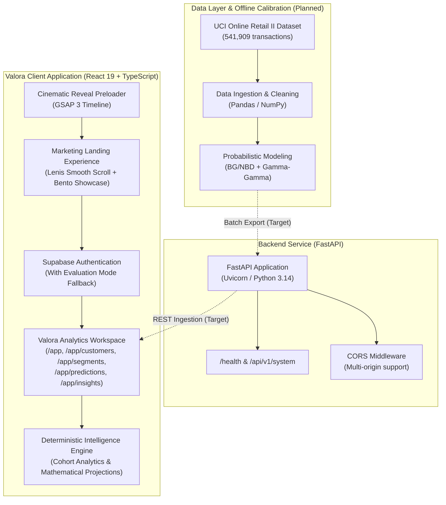
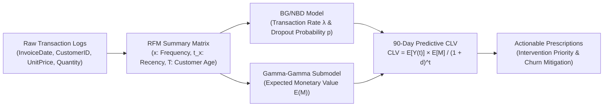

# Valora — Customer Lifetime Value Intelligence Platform

> **Academic Capstone Project**  
> **Repository:** `capstone-01` | **Version:** 1.0.0 (Evaluation Release)  
> **Focus:** Non-contractual customer lifetime value (CLV) intelligence, predictive churn analytics, and RFM behavioral segmentation.

---

## 1. Project Overview & Objectives

**Valora** is a customer intelligence and predictive lifetime value platform designed for non-contractual business environments (such as retail, e-commerce, and merchant platforms). Traditional analytics provide backward-looking transaction summaries. Valora bridges historical behavioral data with probabilistic forecasting models to help revenue leaders:

1. **Quantify Forward Customer Equity:** Predict expected 90-day transaction frequency and net monetary value for active accounts.
2. **Detect Latent Churn Hazards:** Identify high-value customers whose probability of being active ($P(\text{Active})$) has decayed.
3. **Automate Strategic Segmentation:** Group accounts into actionable cohorts (Champions, High Value at Risk, Emerging Potential, Hibernating).
4. **Prescribe Revenue Actions:** Surface prioritized interventions and retention triggers before accounts transition into irreversible dormancy.

---

## 2. System Architecture & Data Flow

Valora employs a decoupled architecture separating high-speed client analytics from offline model calibration and backend service endpoints.



---

## 3. Feature Implementation Matrix

| Module / Capability | Implementation Status | Technical Details |
|---|---|---|
| **Marketing Landing Experience** | **Complete** | GSAP 3 preloader reveal, Lenis smooth scrolling, Bento product showcase, theme switching, route prefetching. |
| **Authentication & Session Gate** | **Complete** | Supabase Auth with dynamic ESM loading, local demo session bypass, protected workspace routing. |
| **Workspace Overview Dashboard** | **Complete** | Real-time KPI cards, CLV distribution histograms, 90-day trajectory forecasts, segment health breakdown. |
| **Customer Directory & Profile** | **Complete** | Multi-attribute search, RFM metrics, $P(\text{Active})$ gauge, purchase history timeline, cohort analytics. |
| **Customer Segmentation** | **Complete** | 6 behavioral cohorts, revenue contribution charts, segment drilldown, migration risk matrix. |
| **CLV & Predictive Intelligence** | **Complete (Demo/Mock Engine)** | BG/NBD frequency estimates, Gamma-Gamma monetary valuations, 90-day forward predictions, confidence bands. |
| **Actionable Insights & Prescriptions** | **Complete (Demo/Mock Engine)** | Automated priority cards, churn intervention playbook, expected ROI calculation, dismiss/action workflows. |
| **Backend System Endpoints** | **Complete** | FastAPI service with `/health`, `/api/v1/system`, CORS middleware, structured logging, error handling. |
| **Backend Business Endpoints** | **Not Implemented** | `/api/customers`, `/api/predictions`, and `/api/segments` pending database migration. |
| **Database & Persistence** | **Not Implemented** | PostgreSQL schemas and Alembic migrations planned for post-evaluation phase. |
| **Offline Data & Training Pipeline** | **Not Implemented** | `data-pipeline/` scripts for UCI Online Retail II batch training with `lifetimes` / `scikit-learn`. |

> **Note on Evaluation Environment:**  
> The client currently operates in **Evaluation / Demo Mode**. All figures and forecasts in the workspace are generated deterministically by the frontend intelligence engine (`segmentAnalytics.ts`, `predictionAnalytics.ts`, `insightsAnalytics.ts`) over a representative 36-account cohort. The application functions completely standalone without requiring database provisioning.

---

## 4. Methodological Framework: Non-Contractual CLV

Valora adopts the industry-standard **Buy 'Til You Die (BTYD)** modeling paradigm for non-contractual transactional dynamics.



### Mathematical Formulation
1. **Transaction Frequency ($X$) & Recency ($t_x$):**
   * Model: **BG/NBD (Beta-Geometric / Negative Binomial Distribution)**.
   * Assumes transaction rates $\lambda \sim \text{Gamma}(r, \alpha)$ across customers.
   * Dropout point follows a geometric distribution with probability $p \sim \text{Beta}(a, b)$.
2. **Monetary Value ($M_x$):**
   * Model: **Gamma-Gamma Sub-model**.
   * Assumes transaction values are independent of the transaction process and gamma-distributed across individuals.
3. **Forward Horizon Revenue Prediction ($CLV_{90}$):**
   $$\mathbb{E}[CLV_{90}] = \mathbb{E}[X(t)] \times \mathbb{E}[M]$$
   Where $\mathbb{E}[X(t)]$ is the expected transaction count over a 90-day window given historical $(x, t_x, T)$, and $\mathbb{E}[M]$ is the estimated mean monetary transaction value.

---

## 5. Technology Stack

### Frontend
* **Core:** React 19, TypeScript, Vite 8, React Router 7
* **Styling & Design System:** Tailwind CSS 4, CSS custom properties, Dark/Light semantic design tokens
* **Motion & Polish:** GSAP 3, GSAP ScrollTrigger, Lenis smooth scrolling, Motion (Framer Motion 14)
* **Data Visualization:** Recharts 3, Lucide Icons
* **Forms & Validation:** React Hook Form, Zod
* **Authentication:** Supabase Client (dynamically imported)

### Backend
* **Framework:** FastAPI (Python 3.14 compatible)
* **ASGI Server:** Uvicorn
* **Configuration:** Pydantic-Settings BaseSettings
* **Logging:** Structured standard library logging with request tracing
* **Testing:** Pytest, HTTPX, FastAPI TestClient

---

## 6. Getting Started & Setup

### Prerequisites
* **Node.js:** v20.x or v22.x+ (Tested on v24.21.0)
* **npm:** v10.x+
* **Python:** v3.11+ (Tested on Python 3.14.0)

### 1. Frontend Setup & Execution
```bash
# Navigate to frontend directory
cd frontend

# Install dependencies
npm install

# Copy environment variables
cp .env.example .env

# Start development server
npm run dev
```
The application will launch at `http://localhost:5173`.

### 2. Backend Setup & Execution
```bash
# From repository root, create virtual environment (if not already present)
python -m venv .venv

# Activate virtual environment
# Windows:
.venv\Scripts\Activate.ps1
# Unix/macOS:
source .venv/bin/activate

# Install dependencies
pip install -r backend/requirements.txt

# Start backend development server
uvicorn backend.app.main:app --host 127.0.0.1 --port 8000 --reload
```
API endpoints available at:
* Health Check: `http://127.0.0.1:8000/health`
* System Information: `http://127.0.0.1:8000/api/v1/system`
* Interactive API Docs: `http://127.0.0.1:8000/docs`

---

## 7. Verification & Automated Test Suites

### Frontend Verification
```bash
# Check TypeScript compilation and create production bundle
npm --prefix frontend run build

# Run ESLint linting verification (0 errors expected)
npm --prefix frontend run lint

# Run Prettier code style check
npm --prefix frontend run format:check
```

### Backend Verification
```bash
# Run pytest automated test suite (3 tests passing)
.venv/Scripts/pytest.exe tests/test_api.py -v
```

---

## 8. Academic Demonstration Walkthrough

When presenting Valora for academic evaluation:

1. **Preloader & Brand Reveal (`/`):**
   * Experience the minimal cinematic counter transitioning from 0% to 100%.
   * Observe the upward curtain lift and coordinated hero choreography.
2. **Marketing Overview:**
   * Review the problem framing, Bento platform showcase, and methodology breakdown.
   * Demonstrate the theme switcher (light/dark mode) in the navigation bar.
3. **Workspace Entry (`/app`):**
   * Click **"Explore Workspace"** to enter the analytics suite (instant evaluation access).
   * **CLV Overview (`/app`):** Examine the portfolio-level KPIs, 90-day trajectory forecasts, and value distribution.
   * **Customer Directory (`/app/customers`):** Search, filter, and inspect individual accounts (e.g., sort by highest churn risk).
   * **Customer Detail (`/app/customers/:id`):** View an account's historical recency/frequency, $P(\text{Active})$ metric, and purchase history.
   * **Customer Segments (`/app/segments`):** Inspect behavioral cohorts (Champions vs. At Risk) and drill down into segment health metrics.
   * **Predictions (`/app/predictions`):** Review forward 90-day predictions, predicted order counts, and confidence intervals.
   * **Insights & Prescriptions (`/app/insights`):** View prioritized intervention recommendations with estimated revenue recoveries.

---

## 9. License & Academic Attribution
Developed as an academic capstone project (2026). Code and documentation are structured for reproducibility and demonstration readiness.
